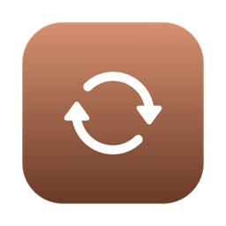
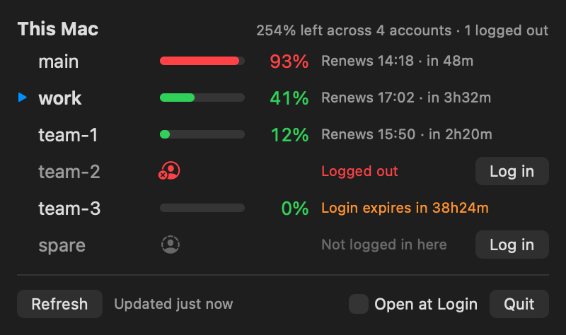

# Claude Swap



A menu bar view for people who run Claude Code on more than one account with a
`claude-swap` style script: which account is in use, how much of each session
is used, when each renews, and which logins have expired.



- The menu bar shows the account in use and its session usage, e.g. `work 41%`.
  The icon gains a `!` when an account is logged out or the script has stopped.
- Click it for every account: usage bar, renewal time, weekly limits (hover a
  row), and a red **Logged out** for any login that needs doing again.
- **Use** (hover a row) switches to that account now.
- **Log in** runs your login helper, opens the sign-in link and takes the code.
- A second machine (say a desktop reached over ssh) can be shown underneath.

The app holds no tokens and never reads the keychain. It only reads a small
status file that your script writes, and runs your own commands when you click.

## Install

```sh
brew install --cask mafex11/tap/claude-swap-bar
open -a "Claude Swap"
```

macOS 13 or later. It opens at login after the first start (there is a
checkbox in the panel).

## The status file

The app reads `~/.claude-swap/status.json`. Your script should rewrite it about
once a minute (the app warns when it is more than 5 minutes old). Times are
Unix seconds. No tokens belong in it.

```json
{
  "version": 1,
  "written_at": 1800000000.0,
  "machine": "macbook",
  "threshold": 90,
  "active": "work@example.com",
  "last_swap_at": 1799996000.0,
  "accounts": [
    {
      "email": "work@example.com",
      "name": "work",
      "login": "ok",
      "active": true,
      "session_percent": 41,
      "session_resets_at": 1800012720.0,
      "weekly": [{"label": "all", "percent": 22, "resets_at": 1800259200.0}],
      "extra_usd": 0.0,
      "checked_at": 1799999910.0,
      "login_expires_at": 1801728000.0
    }
  ]
}
```

`login` is `ok`, `logged_out` (expired or signed out: log in again) or
`missing` (never logged in on this machine). A full example is in
[`docs/sample-status.json`](docs/sample-status.json).

## Settings

Set with `defaults write dev.mafex.claudeswap <key> <value>`, then restart the app.

| Key | Default | What it is |
| --- | --- | --- |
| `statusFile` | `~/.claude-swap/status.json` | The status file for this Mac |
| `swapCommand` | `~/.local/bin/claude-swap` | Run as `<cmd> use <email>` (Use) and `<cmd> tick` (Refresh) |
| `loginHelper` | `~/.claude-swap/login.sh` | Run as `<helper> start <name>` (last line of output = sign-in link) and `<helper> finish <name> <code>` |
| `remoteName` | none | Title of a second machine's section, e.g. `PC` |
| `remoteStatusCommand` | none | Shell command that prints that machine's status file, e.g. `ssh pc cat .claude-swap/status.json` |
| `remoteLoginHelper` | none | Login helper for the second machine (same contract) |

The **Log in** button only appears when the helper exists and is executable.

## Build

```sh
swift test
./packaging/make-app.sh        # builds "Claude Swap.app"
./packaging/make-release.sh    # tests, builds, zips, stamps the cask's sha256
```

`"Claude Swap.app/Contents/MacOS/ClaudeSwap" --render status.json out.png`
draws the panel to a picture, which is how the screenshot above is made.

## License

MIT
